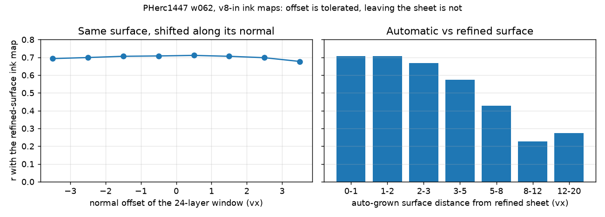

# How reproducible is a tracks-only spiral fit on a Grand-Prize-eligible scroll?

*Sebastien Chicoineau and Chris Thomas*

*Seed spread, umbilicus error and estimation, two negative results (9.362 µm eligible scrolls), and what these surface errors cost an ink model (public PHerc1447 data)*

> **Author's note.** We started out trying to improve tracks-only spiral fits on the eligible scrolls by recovering large dropped track components and testing how sensitive the fitter is to its inputs. Along the way, we hit several traps: the dropped components turned out to be a border artifact outside the scroll, a promising visual rating gain on a single seed disappeared once we tested multiple seeds, and our first surface-distance metric was fooled by the 20-voxel mesh grid. Once we switched to measuring point-to-surface distance and turn agreement, we found that different seeds produce nearly the same surfaces (~1 voxel apart, harmless for ink in our one test), but shifts of a few tenths of a millimetre in the scroll centre already change how the windings are numbered. I guided the experiments and did the blind image ratings myself, Chris ran the PHerc0139 accuracy checks on AMD GPUs and reviewed the runs, and Claude (Opus 5.5) wrote the scripts and ran the analysis.

**TL;DR.** We ran villa's `fit_spiral.py` with the tracks-only recipe proposed in PR #1837 (closed unmerged on 2026-10-04) on 1,000-slice bands of two
eligible scrolls, changing one input at a time, and compared the fitted windings by **where they sit** and **which
turn they are assigned to**.

**Scope (read first).** (a) Fits are compared with each other: no result here says which fit is on the right sheet; this is a *sensitivity* measurement, not an accuracy one. The one exception is §4.4, which scores PHerc0139 fits against the organizers' labelled wraps. (b) Only the tracks-only recipe of the unmerged PR #1837 was tested; fits with winding annotations or patches (the organizers' stated priority) were not. (c) The centre shifts are synthetic and rigid, on one band per scroll.

1. **Seeds: the surfaces reproduce, and the turn numbering mostly does.** Same inputs with another
   `optimizer_random_seed`: the fitted windings lie a median **0.8–1.4 voxels** from each other (79–89% within
   4 vx; seed pairs on 3 bands, 2 scrolls). Where they coincide, 64–91% carry the same turn number and the rest are one
   turn off. The outer sector range is 0 in most seed pairs and 1 in two (seed 4 vs seeds 1 and 2), which is why the
   tolerance rule below allows a range of 1 (§3, §4.2).
2. **Umbilicus: the turn numbering reacts to small centre errors.** Turn agreement falls with every centre shift we tried. By our pre-registered rule a rigid +y shift is first flagged between 0.09 and 0.23 mm on PHerc0211 (any share margin 0.04-0.15), below 0.23 mm in +y on PHerc0826, and below 0.47 mm in +x on 0826 (0211 +x: not decided). 5 fitter seeds per shifted centre at 0.47 mm on 0826 (3 at 0.23 mm), 3 on 0211, one 1,000-slice band each. In every test, every
   shifted-vs-unshifted turn agreement is below every unshifted pair (no margin needed; on 0211 +x by only 0.004).
   On 0211 the mean agreement falls from 0.900 between unshifted fits to 0.859 / 0.723 / 0.492 across centres 0.09 / 0.23 / 0.47 mm apart (§4.2, §4.3).
   At large shifts the per-sector offsets spread over 20 (+x) and 30 (+y) turns at 4.7 mm (one fit per shift).
   *Illustration, post hoc (n = 1):* a 2.3 mm shift moved the windings only 2.0 vx, yet the outer windings, which
   enclose both centres, are numbered +7 turns apart on one side and −1 to −2 elsewhere (`figs/turn_offsets_by_sector.png`).
   **For scale:** two published human umbilici of the same scroll (TAUIL vs Drobkov, other scrolls than these two)
   differ by a median 1.64–4.99 mm in-band, with 86–100% of bands above 0.47 mm (§4.2).
3. **A measurement pitfall worth knowing.** `fit_spiral` writes each winding on a 20-voxel vertex grid, so the
   nearest-*vertex* distance between two identical surfaces is already a median 5–8 vx. The first version of this
   note reported "6.9 voxels apart" from that metric; it was mostly the grid (§2). `scripts/fit_compare.py` measures
   point-to-surface distance and turn agreement instead.
4. **Negative result:** components dropped by the track extractor's size cap (`max_area_threshold`) lie 94–100% outside
   the scroll body, a chunk-aligned border artifact. Recovering tracks from them did not help. The cap is correct (§7).
5. **villa's own umbilicus tool, run densely, is about as close to the reference axes as two people are to each
   other, except on one-sided scrolls.** `vc_gen_umbilicus` (with #1823's fix), 21 repeats every 50 slices: median
   0.81–1.75 mm from the published axes of PHerc0125 / 0211 / 0139, against the 2.2 mm that #1823 reports between two
   human annotations of one scroll; but 4.3–5.0 mm on PHerc0826, worse than the plain envelope centroid (3.1 mm) (§6.1).
6. **What these distances mean for ink (public PHerc1447 data).** The public 8 µm ink model v8-in barely notices a
   surface shifted ±3.5 vx along its normal (agreement with the refined-surface map 0.68–0.71), but where the team's
   automatic surface leaves the hand-refined sheet, agreement falls from 0.71 (≤ 2 vx apart) to 0.57 (3–5 vx) and 0.43
   (5–8 vx). So the ~1 vx seed spread of §3 is harmless for ink; what costs ink is a surface that slides off its
   sheet, which is what the 4 vx threshold and the turn agreement above track (§8, `figs/ink_vs_surface_error.png`).

**Related upstream work.** villa #2029 (open, 2026-10-11) reports that the umbilicus loss and the model's transform use
two different centres (the model uses a σ = 75-slice smoothed axis). Rigid shifts commute with that smoothing, so the
SEED / TOL / Y10 / Y25 tests are unaffected, and DRIFT-TOL (a linear tilt) is unaffected away from the band ends;
REALAXIS (a real, wiggly axis) and the 0.3–0.6 mm point-to-point wiggle of §6.1 are partly smoothed away by the model,
although the umbilicus loss still sees the raw axis. villa #1621 (a satisfaction score cannot see a whole-winding
displacement) is why we compare turn numbers (§2).

**For anyone comparing spiral-fit variants:** compare surfaces point-to-surface, not vertex-to-vertex; compare turn
numbering, not just position; and run several seeds, as villa's own `spiral-fitting/autoresearch.md` already advises.

---

## 1. Setup

- **Paths:** the scripts keep fits, bands and caches under a work root `$R3` (default `~/r3`), and inputs under
  `$DATA/<SCROLL>_<VOLID>` (default `~/data`); set `R3` / `DATA` to use others.
- **Fitter:** villa `spiral-fitting/fit_spiral.py` at `f4570bf` (byte-identical `fit_spiral.py` / `config.py` at villa
  main `d63d3e9`, 2026-10-11; villa main has changed both files since, not re-run, §9), run under WSL2 Ubuntu (the native `vc_spiral` extension
  does not build on Windows without MSVC; `scripts/wsl_setup.sh`), on an RTX 5070 Ti 16 GB: about 14 it/s, a 30k-step
  fit in about 40 min, about 5–7 GB VRAM.
- **Recipe:** the tracks-only overrides proposed in PR #1837 (closed unmerged on 2026-10-04; we record them here so the runs stay reproducible):
  - `input_use_tracks`, `input_disable_patches`, `input_use_outer_shell: false`;
  - `dense_spacing_mode: grad_mag` at weight 0;
  - 30,000 steps;
  - `shell_outer_winding_idx` = `model_gap_expander_num_windings` = N, where N = ceil(1.2 × max m7 sheet crossings
    over 8 radial rays from the umbilicus at the band centre) (`scripts/wind_count.py`, `results/winding_counts.json`).
- **Inputs** (`scripts/assemble_dataset.py`): the published `tracks/` store; the published umbilicus; lasagna nx/ny
  (group 2) chunks covering the band; `spiral-scroll.json` with the catalog's `z_direction_is_top_to_bottom` /
  `left_handed_coordinates`.
- **Bands:**

  | Scroll | Volume | Band | N |
  |---|---|---|---|
  | PHerc0826 | `20250821151701` | [10208, 11208) (pilot), [8136, 9136) | 70, 110 |
  | PHerc0211 | `20250821151803` | [10496, 11496) (pilot), [8328, 9328) | 100, 99 |

- **Track arms** (only the tracks change): A = published tracks; A\* = A minus a random 5%; B = A + tracks from the
  size-capped components; C = B with fused stretches cut (§7).

## 2. How to compare two fits

- `fit_spiral` exports each winding as a tifxyz grid with `scale` 0.05, i.e. one vertex every 20 vx
  (`output_step_size`). Two fits of the same surface place their vertices differently along it.
- **Grid floor** (`results/fit_compare.json`, `grid_floor`): for two *identical* surfaces whose grids are offset at
  random, the nearest-vertex distance has a median of **8.0 vx** (12.5% within 4 vx) for a 2-D offset and **5.0 vx**
  (40% within 4 vx) for a 1-D offset. The sheet spacing is about 14 vx, so this metric cannot separate "the same
  surface" from "half a sheet away".
- **What `scripts/fit_compare.py` measures instead** (for every vertex of fit Q against baseline fit B):
  1. **point-to-surface distance:** the smallest |normal offset| to B among the 8 nearest B vertices whose tangential
     offset is ≤ 15 vx (normals from B's grid);
  2. **turn agreement:** each vertex gets a continuous turn number t = winding index + position along the winding.
     For Q vertices within 4 vx of B, dt = t_B − t_Q, rounded. This is seam-free. A constant dt is a harmless
     relabel; a dt that changes around the scroll means the two fits number the sheets differently;
  3. the **modal dt per 45° sector** (around the published umbilicus) in the inner, middle and outer third of the
     windings, and the **outer sector range** (max − min of the outer sector modes; 0 for a pure relabel).
- Checked: with `input_disable_patches` the `_spliced` meshes equal the non-spliced ones (every log reports
  `splice rasterization: 0 eligible quads`); 99% of compared vertices have an interior nearest baseline vertex, so the
  surface extent does not bias the numbers.
- **Disclosure.** The metric was changed after the first version of this note (an independent review found the grid
  floor). The umbilicus-sensitivity test of §4.1 was pre-registered on the nearest-vertex metric; its re-reading below
  is post hoc. The tolerance curve of §4.2 was pre-registered with the new metric, before its fits ran.

## 3. Seed spread

`scripts/run_fit_compare.sh` → `results/fit_compare.json`. Same band, same tracks, another `optimizer_random_seed`:

| Band | Pairs (arm: seeds) | Point-to-surface median | Within 4 vx | Same turn number | Outer sector range |
|---|---|---|---|---|---|
| PHerc0826 [8136, 9136) | A: 1–2 | 1.33 vx | 0.79 | 0.67 | 0 |
| PHerc0826 [10208, 11208) | A: 1–2, 1–3, 2–3; C: 1–2, 1–3 | 0.79–0.96 | 0.83–0.87 | 0.81–0.88 | 0 (all 5) |
| PHerc0211 [10496, 11496) | A: 1–2, 1–3, 2–3; C: 1–2, 1–3 | 0.92–1.08 | 0.85–0.89 | 0.89–0.91 | 0 (all 5) |

- The fitter reproduces its surfaces to about 1 vx. Every seed pair in this table numbers the windings the same way in
  every sector (range 0); on the [8136) band, seed 4 differs by one turn in one sector (§4.2);
  the 9–33% of co-located surface that differs is one turn off, scattered.
- Nearest-vertex distance on the same pairs: 5.4–6.9 vx, at the grid floor.
- **Track arms against the same yardstick** (vs arm A, seed 1): A\* (−5% tracks) 1.01–1.49 vx, same turn 0.60–0.86; C
  1.54–1.86 vx, 0.45–0.77; B 1.91–2.15 vx, renumbered by a near-constant **+2 (0211) / +3 to +5 (0826)** turns: B's
  extra tracks come from the border ring outside the scroll (§7) and push the outer windings out.

## 4. Umbilicus

### 4.1 One shift: +250 vx (2.3 mm) in x (pre-registered test, post-hoc metric)

`scripts/umb_sens.sh`; PHerc0826 [8136, 9136), arm A; the S fit (shifted, seed 1) and R fit (unshifted, seed 2) against
the seed-1 baseline.

| Fit | Nearest-vertex median / within 4 (as pre-registered) | Point-to-surface median / within 4 | Same turn number | Outer sector modes (0°…315°, 0° = +x) |
|---|---|---|---|---|
| R: seed 2 | 6.90 / 0.208 | 1.33 / 0.786 | 0.67 (offset 0) | 0 0 0 0 0 0 0 0 |
| S: +250 vx x | 8.81 / 0.094 | 2.01 / 0.686 | 0.24 (offset −2) | **+7 +7 −2 −2 −2 −1 −1 −1** |

- **As pre-registered** (share-within-4 ratio S/R on nearest-vertex distance, < 0.5 = "sensitive"): 0.454,
  "sensitive" (`results/umb_sens_result.json`). That metric is at its grid floor (§2).
- **Same thresholds, post hoc, on point-to-surface:** 0.686 / 0.786 = 0.87, "moderate". The surfaces barely move.
- **Turn numbering:** the shift renumbers the inner turns, as it must when the centre moves by about 17 sheet
  spacings. But the outer third of the windings encloses both centres, so a correct fit should differ there by one
  constant offset. It differs by **+7 turns on the shift side and −1 to −2 elsewhere** (range 9;
  `figs/turn_offsets_by_sector.png`). At least one of the two fits assigns turns inconsistently with the sheets; this
  comparison cannot say which.
- For scale: #1716's author found their own umbilicus 234–464 vx from the published one, so 250 vx is the size of a
  real disagreement between two umbilici.

### 4.2 Tolerance curve (pre-registered 2026-09-29)

`scripts/tol_curve.sh` (fits), `scripts/tol_analyze.py` → `results/tolerance_curve.json`,
`figs/umbilicus_tolerance.png`. Same band, tracks and recipe as §4.1; every control point of the published umbilicus
moved by the same vector; each fit compared with the seed-1 baseline by `fit_compare.py`.

- **Rule provenance:** written in our lab log (private team repository) on 2026-09-29 19:36 CDT, before these fits
  ran, and first committed to git on 2026-09-30 (42b732f, same repository). Every later test (§4.3) was pre-registered by its own commit.
  All tests are reported; no multiplicity correction. Evidence unit = fits (5 shifted vs 4 unshifted on 0826, 3 vs 3
  on 0211); on 0211 the exact permutation floor is p = 0.10, so nothing here is claimed as significant.
- **Rule** (lab log, 2026-09-29 19:36 CDT): a shift is *tolerated* iff the outer
  sector range ≤ 1 turn **and** the same-turn share ≥ (lowest of the 3 seed pairs) − 0.10 = 0.54. The tolerance is the
  largest shift on the 50 / 100 / 250 / 500 vx ladder tolerated with every smaller one also tolerated; the headline is
  the smaller of +x and +y.

| Fit | Shift | Point-to-surface median | Same turn number | Outer sector modes (0°…315°) | Range | Verdict |
|---|---|---|---|---|---|---|
| seeds 2 / 3 / 4 | none | 1.33 / 1.35 / 1.40 vx | 0.67 / 0.67 / 0.64 | 0 everywhere (seed 4: −1 in one sector) | 0 / 0 / 1 | noise band |
| +x 50 | 0.47 mm | 1.69 | 0.39 | +1 +1 −1 −1 −1 −1 0 0 | 2 | **not tolerated** |
| +y 50 | 0.47 mm | 1.83 | 0.29 | +1 +1 0 −1 −1 −2 −2 −2 | 3 | **not tolerated** |
| +x 100 | 0.94 mm | 1.82 | 0.32 | +2 +2 −1 −1 −1 −1 0 0 | 3 | (ladder stopped) |
| +y 100 | 0.94 mm | 1.93 | 0.24 | +3 +3 −1 −1 −1 −4 −3 −3 | 7 | |
| +x 250 | 2.34 mm | 2.01 | 0.24 | +7 +7 −2 −2 −2 −1 −1 −1 | 9 | |
| −x 250 | 2.34 mm | 2.21 | 0.27 | −4 −3 +2 +2 +2 +2 +2 −1 | 6 | (descriptive) |
| +y 250 | 2.34 mm | 2.58 | 0.15 | +10 +10 −4 −4 −4 −6 −6 −8 | 18 | |
| +x 500 | 4.68 mm | 2.79 | 0.18 | +15 +15 −4 −5 −5 −4 −3 −3 | 20 | |
| +y 500 | 4.68 mm | 3.26 | 0.13 | +14 +20 −6 −9 −10 −10 −10 −10 | 30 | |

- **Result (this ladder): tolerance < 50 vx (0.47 mm) in both directions.** The smallest shift on this ladder already
  lowers the outer-winding agreement by 1–2 turns depending on angle and halves the same-turn share, while the
  surfaces move only 0.3–0.5 vx more than with a seed change. Smaller shifts were tested later (§4.3): on PHerc0211
  a 0.09 mm +y shift is tolerated by the same rule.
- **Dose response:** the per-sector offsets spread more with each shift, to 20 (+x) and 30 (+y) turns at 4.7 mm (one
  fit per shift); surface distance grows
  from 1.7 to 3.3 vx. The −x shift mirrors +x (the signs flip).
- **Where it happens** (post hoc, one fit per shift): for every shift, including the y shifts, the large offsets sit in the same 0–90° wedge
  (0° = +x around the published umbilicus); the other sectors carry a smaller offset of the opposite sign. So the fit
  absorbs a wrong centre by concentrating the turn-count mismatch in one fixed region, not by a smooth relabel. We have
  not established why that wedge (for example, where the fitter's spiral parameterisation starts, or a feature of this
  band).
- **For scale:**
  - the best current umbilicus estimates are 0.8–1.7 mm from the published axes (villa's `vc_gen_umbilicus` run
    densely, §6.1);
  - two human annotations of one scroll are 2.2 mm apart (#1823);
  - the published reference axes themselves wiggle by 32–63 vx (0.3–0.6 mm) point to point (§6.1).

  So the fitter's turn numbering, under this recipe, reacts to centre-line errors smaller than the disagreement between
  two published human umbilici (TAUIL vs Drobkov: median 1.64–4.99 mm in-band, 86–100% of bands > 0.47 mm, on other
  scrolls). REALAXIS-0211 (§4.3) shows that two centre-line sources disagree enough to move the numbering; it does not
  show that the published axis is outside the tolerance.
- **What it does not say:** which fit is right (the baseline's centre is also uncertain), whether the surfaces sit on
  the sheets, or how other recipes (with patches, fibers or the winding model) behave. One fit per shift, one band of
  one scroll: descriptive, not a significance test.

### 4.3 Follow-up tests (each pre-registered by commit, 2026-10-05 to 10-08; all reported)

Same recipe and rule (`scripts/fit_compare.py`; cross pairs = shifted vs unshifted fits). Evidence:
`results/followups/<test>/` (comparison files + verdict JSON); re-score with `scripts/followup_rescore.py`. Re-scored independently by
the partner's judge (2026-10-08, 10-09, 10-13) from the saved comparison files.

| Test | Scroll, shift | Fits | Cross pairs not tolerated | Reading |
|---|---|---|---|---|
| SEED-3 / SEED-5 | 0826, ±0.47 mm x and y | 5 seeds per shifted centre | +x 19/20, +y 20/20 (within-shift 0/10) | +y robust at every share margin up to 0.15; **+x holds only at the registered 0.10 margin** (0.12 → 16/20, 0.15 → 11/20) |
| TOL-25 | 0826, +y 0.23 mm | 3 + 3 | 12/12 (cross 0.427–0.492) | +y only |
| TOL-0211 | 0211, 0.47 mm | 3 + 3 | +y 9/9; +x 6/9 | +x **not decided** (ordering holds by 0.004) |
| Y25-0211 | 0211, +y 0.23 mm | 3 + 3 | 9/9, share leg only (range leg 0/9, modal offset 0) | **lower agreement**, not a renumbering |
| Y10-0211 | 0211, +y 0.09 mm | 3 + 3 | 0/9: **tolerated** (shares 0.852–0.869, floor 0.791) | the fit still reacts (every cross share below every same-centre pair); only the rule tolerates it. The 0.09–0.23 mm bracket holds for any margin 0.04–0.15 |
| REALAXIS-0211 | 0211, published axis vs a real alternative | 3 + 3 | 9/9 (one same-axis pair falls 0.001 below the floor) | two centre-line sources disagree; re-runs AXIS-SWAP-0211 with its killing run condition dropped (disclosed) |
| DRIFT-TOL | 0826, linear tilt (±0.72 mm at the band ends) | 3 + 3 | 12/12, range leg 2/12 | **lower agreement**; not a small perturbation |
| BASE-SWAP | 0826, swapped baseline | 3 + 3 | +x50, +y50 3/3 | adds little (unshifted fits agree) |

- **Floor-free ordering** (needs no margin): in every test, every shifted-vs-unshifted share is below every unshifted
  pair and every same-shift pair (0826 +y: max cross 0.395 < min within 0.648; 0826 +x: 0.552 < 0.608; 0211 +x:
  0.798 < 0.802).
- **Not excluded:** a tolerance near zero for 0826 (no 0.09 mm run on 0826). Say "sensitive to any perturbation" only
  if such a run also fails.

### 4.4 Accuracy check on a third scroll (pre-registered, SPIRAL-ACCURACY-0139)

On PHerc0139 (9.362 µm, one 1,000-slice
band), the same tracks-only recipe was scored against 34 of the organizers' published verified wraps (w023–w059 without
w030, w045 and w046). With the published umbilicus, the fit put a winding within 6 vx (56 µm) of 82% of the labelled area,
but numbered only 44% of that area consistently with the labels (one global offset allowed; wrong-turn share
0.557–0.558 over 3 seeds; the numbering slips against the labels at 12–13 of 33 wrap steps). Rigid +y umbilicus shifts of
0.09 / 0.23 / 0.47 mm changed the wrong-turn share by +0.0 / +0.15 / +0.89 percentage points (2 seeds each; the 3
unshifted seeds span 0.12 points): all inside the pre-registered 1-point margin, so the shifts are *tolerated* by that rule,
although the 0.47 mm shift would count as an accuracy cost at a 0.5-point margin. The shifted fits still number the
windings differently from the unshifted ones (on this scroll our fit-vs-fit rule again flags +y at 0.23 mm but not at
0.09 mm, descriptive; the PHerc0139 pre-registration had named a stricter floor, under which every shift is
flagged); most of that renumbering falls outside the labelled wraps or moves a turn from one wrong number to another,
which the wrong-turn share does not count. +x shifts were not decided (at most one fit per shift; compute cap). Fits ran on our
ROCm port of the fitter and are compared only with each other; the published m7 tracks may have seen PHerc0139 labels in
training; two label pairs (w034/w035, w041/w042) are inconsistent in this band (without them the 0.47 mm effect is +0.44 points).

Evidence: `results/spiral_accuracy_0139/` (scores, verdicts, fit-vs-fit comparisons, scripts; write-up `RESULT_public.md`;
per-vertex turn concordance between fits in `judge_concordance/`). These fits used villa
`d63d3e9` (`fit_spiral.py`/`config.py` byte-identical to `f4570bf`) built for ROCm (packaging-only patch included) on AMD
R9700 GPUs. The umbilicus and lasagna normals were mapped from the 2.399 µm scan with the catalog's transform. The
comparison instrument is `scripts/fit_compare.py`. The copied scripts keep the paths of the repository they ran in
(`work/spiral_accuracy/...`, and `lanes/A_geometry/tools/fit_compare.py`, the same file as `scripts/fit_compare.py`), and the `prereg` field of each `results/followups/*/verdict.json` names its
pre-registration file in that repository; §10 step 9 shows how to re-score.

### 4.5 Can the fitter find its own centre? (pre-registered 2026-09-30; negative result)

`scripts/centre_search.py` → `results/centre_search.json`, `figs/centre_search.png`; 8 more fits on the same band.

- **Idea.** Use the fitter's own agreement with the tracks (`satisfied_track_points_fraction`) as a score, and look
  for the centre position that maximises it.
- **Rule** (written before the fits):
  - Q1: the −x 2.34 mm gain seen in §4.2 must replicate with another seed, at or above the seed band's max plus its
    range (0.4611);
  - Q2: a quadratic surface fitted to all 21 probes must have a concave maximum inside the probed ±4.7 mm, at or above
    that bar.
- **Values** (published centre, seeds 1–4: 0.455–0.458):

  | Direction | 0.47 mm | 0.94 mm | 2.34 mm | 4.68 mm |
  |---|---|---|---|---|
  | −x | – | 0.455 | **0.465, 0.465** (seeds 1, 2) | 0.465 |
  | +x | 0.451 | 0.444 | 0.441 | 0.411 |
  | −y | – | 0.443 | 0.388 | 0.342 |
  | +y | 0.457 | 0.443 | 0.446 | 0.436 |

  Diagonals: (−2.34, −2.34) mm 0.389; (−2.34, +2.34) mm 0.458.
- **Verdict: FAIL.**
  - Q1 passes: the −x gain replicates exactly.
  - Q2 fails: the surface's maximum extrapolates to (−11.8, +5.2) mm, far outside the probed area, with one curvature
    near zero (a ridge, not a peak) and residuals three times the seed band.
- **Reading.** The score does respond to the centre: it falls by up to 25% when the centre moves −y and falls steadily
  for +x. But it plateaus towards −x instead of peaking, so it cannot place the centre anywhere near the < 0.47 mm that
  the turn numbering needs (§4.2). The score is also periodic in whole windings (#1621), so even a peak would not prove
  the right centre. One band of one scroll.

## 5. What blind ratings can and cannot show

`results/trackfix_seed_ratings.json`, `results/seed_rating_key.json`, `scripts/analyze_seed.py` (pre-registered);
`scripts/rating_noise.py` → `results/rating_noise.json` (post hoc).

- **Design:** 3 seeds × arms A and C × the 2 pilot bands, 8 random 341 × 341 px CT crops per fit at 1 vx/px, rated
  blind by one rater (Sebastien Chicoineau) on a 4-level sheet/swirl scale (Everywhere 3 / Mostly 2 / Some 1 / None 0). The
  rater passed a quiz built from Bullo27's by-eye survey labels (80% agreement, ordering 1.00); repeats 9/10 identical.

  | Band | A seed means | C seed means | Per-seed C − A |
  |---|---|---|---|
  | PHerc0826 | 0.50 / 0.38 / 1.12 | 1.00 / 0.75 / 0.38 | +0.50 / +0.38 / −0.75 |
  | PHerc0211 | 1.06 / 1.12 / 1.00 | 1.00 / 0.88 / 1.12 | −0.06 / −0.25 / +0.12 |

- **Pre-registered verdict:** C − A = +0.04 (0826) and −0.06 (0211), not above the seed range: arm C shows no
  advantage.
- **But random crops cannot measure seed noise.** Shuffling the crop ratings across seeds gives seed-mean ranges as
  large as those observed (0826 A: range 0.75, p = 0.16; the other three p ≥ 0.29). Re-rating the *same* seed-1 fits
  with fresh crops moved them by 0.08–0.64 (0211 A: 0.42 in the pilot, 1.06 here).
- **Why the pilot's "gain" vanished:** on 0211 the single-seed C − A of +0.37 was already within crop noise (p = 0.25);
  on 0826 the +0.67 (p = 0.01) held on seed 1 with fresh crops (+0.50) and reversed on seed 3 (−0.75).
- Lesson: single fits mislead, and rating random crops adds its own noise; paired crops (the same scroll location in
  every fit) would be needed to rate fit differences of this size. Arm B was not seed-replicated; its only rating is
  the single-seed pilot (B − A +0.42 / +0.33, `results/pilot_results.json`).

## 6. Estimating an umbilicus

- **Availability.** Published umbilici exist for three eligible scrolls (PHerc0125, 0211, 0826). Community hand-made
  axes exist for the other ten (AlexeyDrobkovStrikesBack/herculaneum-umbilici; PHerc1218 also by Iyán Dopico,
  IyanDopico/vesuvius-sheet-tools). How much the turn numbering changes at that scale is what §4.2 measures.
- **Two quick estimators we tried did not reach 1 mm at 9 µm** (`scripts/umb_error.py` →
  `results/umbilicus_estimate_errors.json`):
  - convergence point of the lasagna in-plane normals (`scripts/umb_estimate.py`): median error 1.6 / 6.2 / 17.3 mm on
    PHerc0125 / 0211 / 0826 (17 points each);
  - visual core marking by an AI reader (Claude) on grid renders (`scripts/render_slice.py`): 0.28 / 1.07 / 0.53 mm
    on 2.4 µm scans of PHerc0332 / 0139 / Paris4 (pooled 0.58 mm, 19 points), but 2.34 mm on the 9.362 µm scan of
    PHerc0139 (7 points; its reference is the 2.4 µm axis mapped by an affine that was not kept, so this one number is
    not recomputed by the script), and no visible core at all on the flattened PHerc0125.
- The references themselves have unknown accuracy; part of these errors may be theirs.

### 6.1 villa's own tool, run densely (pre-registered 2026-09-29)

`scripts/umb/` → `results/umb/`.

- **Tool:** `vc_gen_umbilicus` (villa `f4570bf`, which includes #1823's weighted-sum fix) on the published m7 xy
  normal-grids, at every slice z ≡ 0 (mod 50) across each reference's z range, `--repeats 21 --seed 1` (the control
  point is the median of the 21; `run_strong.sh`). **Smoothed** = running median in x and y over ±5 samples (±250 z),
  fixed before scoring.
- **References:** the published axes. PHerc0139's 2.4 µm axis is mapped to its 9.362 µm scan by an affine fitted to
  650k same-segment mesh vertex pairs (`affine_0139.py`; median residual 3.4 vx).
- **Scoring** (`score.py`): the xy distance in mm at every reference point.
  - PHerc0211 is scored only below z 13,200. Above it the reference jumps about 10 mm, then alternates between two
    strands (x 2,492 at z 16,052; x 4,164 at z 16,066).
  - Two short z windows (PHerc0125, PHerc0139) are excluded because they were inspected while developing §6.2.

| Scroll | Unsmoothed | Smoothed | Envelope centroid (`env_baseline.py`) | Points |
|---|---|---|---|---|
| PHerc0125 (flattened) | 1.75 mm | 1.73 mm | 2.58 mm | 82 |
| PHerc0211 (z < 13,200) | **0.81 mm** | 0.89 mm | 2.01 mm | 67 |
| PHerc0826 | 4.98 mm | 4.34 mm | **3.12 mm** | 49 |
| PHerc0139 (9.362 µm scan) | 1.23 mm | 1.26 mm | 4.52 mm | 378 |

- **For scale:**
  - #1823 reports that "two independent annotations of one scroll lie 2.2 mm apart". On three of the four scrolls
    the dense tool is inside that disagreement.
  - Its failure case is the one-sided PHerc0826, as #1823 itself warns: "on a very one sided prediction that bias can
    exceed the distance of the centroid baseline". #1823's own table gives PHerc0826 4.27 mm.
- **Repeats and smoothing:**
  - The tool's repeats on one slice scatter by a median 0.24–0.63 mm, so repeats help.
  - Smoothing along z helped only PHerc0826.
- **The reference axes differ in roughness:** each point of the PHerc0125/0211/0826 references lies a median 32–63 vx
  from the chord of its neighbours, against 6 vx for the PHerc0139 reference, so part of each error is the reference's.
- How much the turn numbering changes at 1–1.7 mm is what §4.2 measures.

### 6.2 Negative result: the charge of the sheet-direction field does not mark the core

- **Idea:** the umbilicus as the topological charge (Poincaré index) of the sheet directions, taken from the same
  normal-grids.
  - A round core is one +1 point.
  - A flattened core is a pair of +½ points, with the umbilicus at their midpoint.
  - Crushing should not change the charge.
- **Test:** pre-registered, with a synthetic spiral check and the code frozen before scoring (`chargecore.py`,
  `synth_test.py`, `run_killtest.py` → `results/umb/killtest_result.json`).
- **Result:** median error 14.2 / 8.5 / 8.0 / 2.0 mm (PHerc0125 / 0211 / 0826 / 0139), so it was **killed**.
  - On the crushed scrolls, 7–9 +½ defects per slice survive (merged and split sheets in the m7 prediction).
  - The nearest one is a median 5–14 mm from the reference.
  - Only the least crushed scroll (PHerc0139) shows some signal (`explore_killed.py`, post hoc).

## 7. Negative result: the size-capped components are a border artifact

- `scripts/census.py` re-runs the extractor's ribbon steps with each scroll's published `extract.json` parameters.
  The published PHerc0125 store has 3,970 tracks on ribbon h:7748; our re-run gives 3,972. Components above
  `max_area_threshold` hold **17–55% of the pooled foreground per ribbon** (25–52% per scroll;
  `results/census_*.json`).
- `scripts/giant_where.py` → `results/giant_where.json`, `figs/giant_viz/`: on the middle census ribbon of each of 9
  volumes, **94–100% of their area lies outside the scroll body** (1.000 on eight, 0.937 on PHerc0268).
- `figs/published_tracks_vs_dropped.png` shows published tracks covering the papyrus and the dropped component as a
  chunk-aligned ring around it.
- Recovering tracks from them (B) moved the outer windings out by 2–5 turns (§3); cutting their fused stretches (C)
  gave fits no better rated than A (§5). The cap is correct.

## 8. What these distances mean for ink (public PHerc1447 data)

The distances above are geometry. To see what they cost an ink model, we used the one public place with both a
hand-refined and an automatic surface of the same sheet: PHerc1447 winding w062 (8.64 µm scan, HF dataset
`YoussefMoNader/ink-8um-pherc1447-surfaces`, CC BY-NC) and the team's automatic segment `20250702235910`, which lies on
the same sheet (60% of it within 3 vx of w062). Ink model: v8-in (`YoussefMoNader/ink-8um-v8in`, MIT), never trained
on PHerc1447. Reference: v8-in's published map on the refined w062. Metric: Pearson r after a σ = 4 px blur, on points
matched by nearest 3-D position (`scripts/ink_surface_error.py` → `results/ink_vs_surface_error.json`).

| Test | Result |
|---|---|
| **Same automatic surface, 24-layer window shifted along the normal** (86k points ≤ 1 vx from w062) | r = 0.69 / 0.70 / 0.71 / 0.71 / 0.71 / 0.71 / 0.70 / 0.68 at −3.5 … +3.5 vx |
| **Automatic surface vs refined sheet, by distance between them** | 0–1 vx 0.71 · 1–2 vx 0.71 · 2–3 vx 0.67 · 3–5 vx 0.57 · 5–8 vx 0.43 · 8–12 vx 0.23 · 12–20 vx 0.28 |

- **A surface a few voxels above or below the sheet is fine for this model** (it reads ±11.5 layers).
- **A surface that departs from the sheet is not:** the same 3–8 vx that a depth shift does not notice cost a third to
  half of the agreement when they come from the surface itself sliding, warping or stepping off the sheet.
- For §3–§4: the ~1 vx seed spread sits in the harmless range; the umbilicus-driven 2 vx median shift is near the edge;
  turn disagreement (a surface on another winding, ~14 vx away) is in the range where the ink map is mostly lost.
- Caveats: one winding, one model, agreement with another model's map rather than ground-truth ink; places where the
  automatic surface departs may also be harder papyrus, which this test cannot separate.

## 9. Limitations

- Two scrolls (PHerc0826, 0211) for §3-§4.3 and §4.5; §4.4 adds PHerc0139 (ROCm fits, +y accuracy check only). 1,000-slice
  bands, one scan type (9.362 µm), one recipe (tracks only, no patches).
- Turn agreement compares two fits; it does not say which is right. These fits' placement on the sheets was not tested on
  0826/0211 (the fit audit cited below finds recipe fits there at chance level); §4.4 checks it on PHerc0139.
- One umbilicus shift in §4.1; one fit per shift and one band in §4.2.
- Ratings come from a single rater.
- §6.1 is scored against four reference axes of unknown accuracy (three of them visibly rougher than the fourth), on
  one scan type; PHerc0139's reference passes through a fitted affine.
- The recipe was never reviewed upstream: PR #1837, a README change, was closed by villa's inactivity bot without a
  review, and nothing has replaced it.
- villa main has changed `fit_spiral.py` and `config.py` since `d63d3e9` (checked 2026-10-20); these runs were not
  repeated on the new code.
- The winding direction (`left_handed_coordinates`, `z_direction_is_top_to_bottom`) comes from the catalog and was not
  checked in the scan; community checks of PHerc0826's sense ended unsure (millerandmuller/sense-check).

## 10. Reproduce

1. `VILLA=/path/to/villa bash scripts/wsl_setup.sh` (inside WSL Ubuntu).
2. `python scripts/assemble_dataset.py SCROLL VOLID Z0 Z1 0` and `bash scripts/run_band.sh SCROLL VOLID Z0 Z1` (arm
   track stores A / A\* / B / C with crossings).
3. `FITROOT=... SEED=... bash scripts/pilot_fit.sh SCROLL VOLID Z0 Z1 N ARM`; umbilicus shifts: `scripts/umb_sens.sh`,
   `scripts/tol_curve.sh`.
4. Compare fits: `bash scripts/run_fit_compare.sh` (or `python scripts/fit_compare.py OUT.json UMBILICUS.json
   NAME=BASE_RUN:OTHER_RUN`); tolerance: `python scripts/tol_analyze.py FITS_ROOT UMBILICUS.json`; figures:
   `python scripts/make_turn_figs.py`.
5. Ratings: `python scripts/render_fit.py ...` → `python scripts/seed_rating.py` → `python scripts/analyze_seed.py
   RATINGS.json`; `python scripts/rating_noise.py`.
6. Follow-up tolerance tests (§4.3): `python scripts/followup_rescore.py` re-scores all eight from the shipped
   `results/followups/<test>/compares.json` (each test's verdict JSON is beside it) with the frozen rule, including the
   share-margin sweep and the floor-free ordering.
7. Umbilicus estimators (§6.1–6.2), run in `scripts/umb/`, where everything is read and written next to the scripts:
   1. `bash get_truth.sh`, then `python affine_0139.py`;
   2. `python fetch_grids.py SCROLL Z0:Z1:50` for each scroll (ranges in `run_strong.sh`);
   3. `bash run_strong.sh`, then `python score.py "strong_{sc}.json"` (unsmoothed);
   4. `python env_baseline.py`;
   5. `python run_killtest.py`, which also scores the smoothed tool.
7. Ink vs surface error (§8): download the data listed in `scripts/ink_surface_error.py`, then
   `DATA=... python scripts/ink_surface_error.py infer` (GPU, ~35 min on a 16 GB card) and `... score`.
8. First-version metric (kept for comparison): `scripts/geom_compare.py` → `results/geom_compare.json`,
   `scripts/umb_sens_compare.py` → `results/umb_sens_result.json`.
9. PHerc0139 accuracy check (§4.4): the fits themselves cannot be re-run from this package alone (they need the ROCm build
   from `results/spiral_accuracy_0139/spiral_rocm.patch` and the mapped inputs; they ran on AMD R9700 GPUs). The decision rules can be
   re-applied to the shipped scores: copy `results/spiral_accuracy_0139/out` and `.../scripts` into `R/work/spiral_accuracy/`
   for any empty folder `R`, then run `python -I R/work/spiral_accuracy/scripts/summarize.py`; it rewrites
   `out/verdict.json`, which should equal the shipped one.

Names inside frozen outputs: some result files and script comments cite our lab log (`04_Work_Log.md`), pre-registration
files (`prereg/...`) or other paths of the private team repository they ran in; `results/spiral_accuracy_0139/RESULT_public.md`
also cites the team's internal review and pull request. They are kept unchanged on purpose.

## Prior work and credits

- **Seeds:** villa `spiral-fitting/autoresearch.md` already warns that the fitter is seed-sensitive and gives the
  argument for comparing several seeds; the advice above is theirs. This note adds the size of the spread on eligible
  tracks-only fits.
- **Umbilicus:** #1716 (ttendoscopie-creator) measured that moving the axis by 464 vx barely changes the fitted winding
  spacing of a *no-tracks* fit; §4 looks at per-vertex turn numbering *with* tracks. PR #1837 (gmDevi) documents the
  tracks-only recipe used here and the by-hand umbilicus route with its caveats; #1736 proposed umbilicus estimators.
  PR #1823 (evilaliv3) fixed and validated `vc_gen_umbilicus` against 15 manual axes, and reported the 2.2 mm
  human–human disagreement; §6.1 re-measures that tool run densely on 9.362 µm references. PR #2123 (EconLearn, open
  since 2026-10-16) adds an optional `--uncrush` to `vc_gen_umbilicus` for crushed scrolls and reports estimates closer
  to hand-made axes; it is not tested here.
- **Comparing fits:** Nicodol/spiralcheck scores each fit against held-out human patches and diffs two reports;
  `scripts/fit_compare.py` compares two fits to each other with no labels, by point-to-surface distance and per-sector
  turn numbering. spiralcheck's seam-aware continuous winding coordinate is close to our continuous turn number (§2).
  PR #1866 (jonmarrs, closed) noted the same ~20 vx grid effect on flattened tifxyz output; §2 measures it on
  `fit_spiral` winding meshes.
- **Umbilici:** published axes for PHerc0125/0211/0826; community axes for ten more eligible scrolls by
  AlexeyDrobkovStrikesBack (herculaneum-umbilici), whose README asks for a `fit_spiral`-based sensitivity test; PHerc1218
  also by Iyán Dopico.
- **Fit quality:** claudepro1515/first-letters-fit-audit (September 2026) tests whether recipe fits of 0826/0211 sit on
  the sheets (at chance, by its model-free test); this note is about reproducibility; its one placement check is §4.4 (PHerc0139, against published labels).
- Also: #1909 and millerandmuller/sense-check (spiral sense), bnleft/first-light-pherc0211 (recipe fits on 0211).
- **Ink model and 1447 data (§8):** YoussefMoNader's v8-in model (MIT) and PHerc1447 surfaces/predictions (CC BY-NC);
  the automatic segment and surface volume from the Vesuvius Challenge open data.
- Rater-training images from Bullo27's first-letters-survey (MIT), with his by-eye verdicts (the training page is not
  in this repository).

AI-assisted (Claude Opus 5.5, Anthropic); human-directed; ratings by Sebastien Chicoineau; geometry computed by the scripts here.
